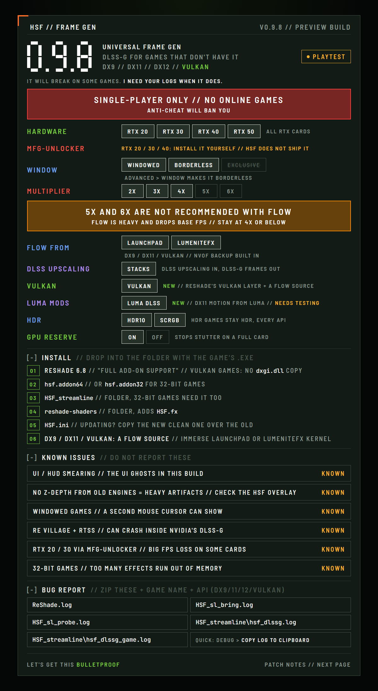
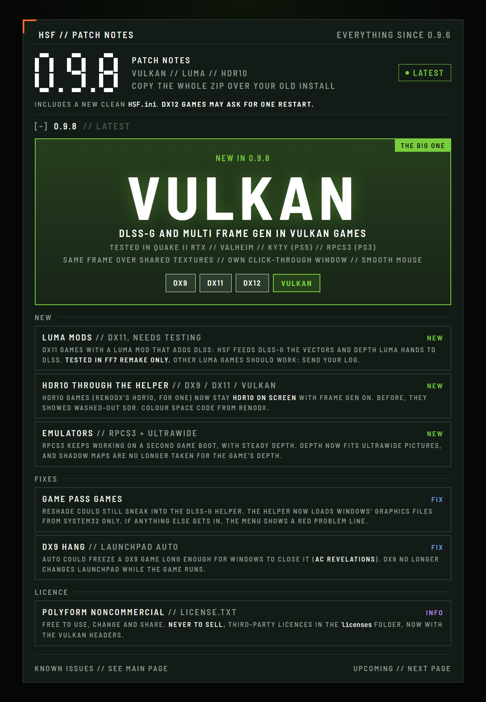
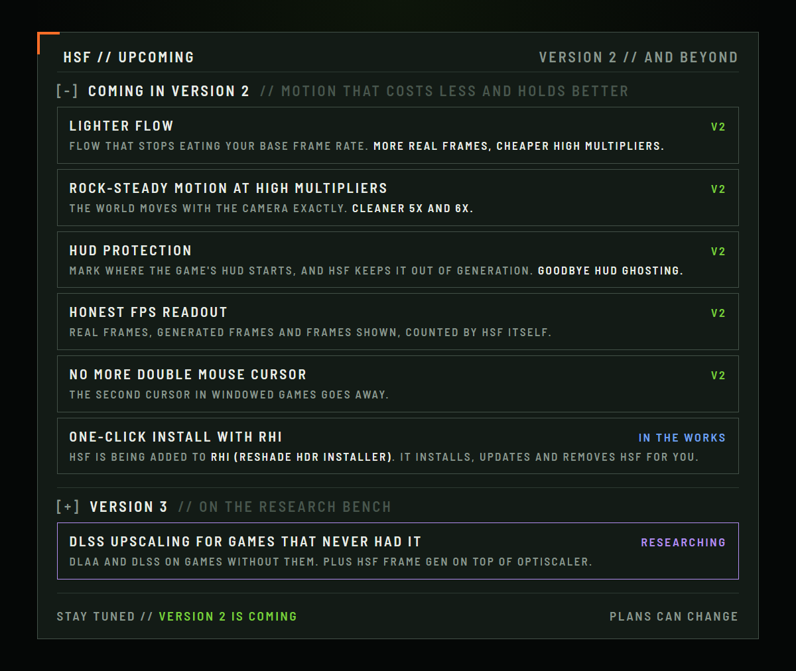

<h1 align="center">HSF — Hunter's Sloppy Frames</h1>

<p align="center"><b>NVIDIA DLSS Frame Generation for games that never had it.</b><br>
A ReShade add-on. Up to 6x. DirectX 9, 11, 12 and Vulkan. 32-bit and 64-bit. SDR and HDR.</p>

<p align="center">
  <a href="https://github.com/Capt-Hunter/HSF/releases"><b>Download</b></a> ·
  <a href="docs/user-guide.md"><b>User guide</b></a> ·
  <a href="docs/troubleshooting.md"><b>Troubleshooting</b></a> ·
  <a href="#install"><b>Install</b></a>
</p>

<p align="center">
  <a href="docs/images/hsf-main.png"></a>
  <a href="docs/images/hsf-patch.png"></a>
  <a href="docs/images/hsf-upcoming.png"></a>
</p>
<p align="center"><sub>Click a card to see it full size.</sub></p>

> **Status:** preview (0.9.8). HSF runs in a wide range of games across DX9, DX11, DX12 and Vulkan, from old 32-bit titles to path-traced ones, and in PS3 and PS5 emulators. If a game misbehaves, send the log: see [troubleshooting](docs/troubleshooting.md).

## What you get

- **Frame generation in games without it.** HSF feeds DLSS-G, at 2x up to 6x, depending on your card.
- **Every common API.** DirectX 9, 11 and 12 and Vulkan, old 32-bit games included, and PS3 and PS5 emulators.
- **HDR stays HDR.** HDR10 goes to DLSS-G as HDR10, and FP16 (scRGB) is turned into HDR10. No setting needed.
- **The best motion it can find.** When a game runs DLSS, HSF uses the game's own motion vectors and depth. In DirectX 11 games that a [Luma](https://github.com/Filoppi/Luma-Framework) mod adds DLSS to, it reads what Luma hands to DLSS. Every other game gets optical flow from a ReShade effect, which HSF combines with the game's depth and cleans up.
- **Its own menu.** A tab in ReShade for the multiplier, FPS cap, Reflex, motion source, HUD protection and two overlays.

## What you need

- An NVIDIA RTX GPU and a current driver. RTX 50 cards get up to 6x. On older RTX cards, MFG-Unlocker (installed separately; HSF never ships it) can add more.
- ReShade 6.8 with **full add-on support** (DirectX 9 needs 6.5 or newer).
- For games without DLSS: a flow source, iMMERSE LaunchPad or LumeniteFX Kernel (with its `include` folder). Download it yourself from its official page.
- A single-player game. **Never use HSF in games with online anti-cheat.**

## Install

### The easy way: RHI

HSF is being added to [RHI (ReShade HDR Installer)](https://github.com/RankFTW/RHI) by RankFTW. Once it is in, RHI installs, updates and removes HSF for you, along with ReShade and the flow source.

### By hand

Download the latest `HSF-<version>.zip` from [Releases](https://github.com/Capt-Hunter/HSF/releases). `<game>` is the folder that holds the game's exe.

1. Install ReShade with full add-on support into `<game>`.
2. Copy `hsf.addon64` (64-bit game) or `hsf.addon32` (32-bit game) into `<game>`.
3. Copy the `HSF_streamline` folder into `<game>`. 32-bit games need it too.
4. Copy the `reshade-shaders` folder into `<game>`. It adds `HSF.fx`.
5. Copy `HSF.ini` into `<game>`, replacing any old one.
6. Start the game, open ReShade and go to the **HSF** tab. Turn FRAME GEN on.

DirectX 12 games ask for one restart the first time, while HSF sets up. Vulkan games need ReShade's Vulkan layer: a `dxgi.dll` copy of ReShade in the same folder keeps HSF out. The [user guide](docs/user-guide.md) covers each game type, the menu and the hotkeys.

Making an installer or mod manager? Read [Installing HSF from a tool](docs/installers.md).

## Something wrong?

Open the HSF tab: the WAITING or PROBLEM line says why. [Troubleshooting](docs/troubleshooting.md) lists the common messages and their fixes. For a bug report, use COPY LOG TO CLIPBOARD (DEBUG section) and send the log.

## Documentation

**Players:** [User guide](docs/user-guide.md) · [Troubleshooting](docs/troubleshooting.md) · [Settings (`HSF.ini`)](docs/settings.md)

**Installers and mod managers:** [Installing HSF from a tool](docs/installers.md)

**Developers:** [Architecture](docs/architecture.md) · [Source map](docs/source-map.md) · [Building and testing](docs/building-and-testing.md) · [Contributing](CONTRIBUTING.md)

<details>
<summary><b>How it works</b>: the route HSF picks for each game</summary>

<br>

HSF picks a route for each game. The menu shows which one is running.

| Game | Route | Where DLSS-G runs |
|---|---|---|
| DX12, ships Streamline 2.x | **In game**: HSF drives the game's own Streamline | the game's device and swap chain |
| DX12, no Streamline | **Bring-in**: HSF loads its own Streamline 2.14 into the game | the game's device and swap chain |
| DX11 (32 and 64-bit) | **Helper**: frames go to `hsf-dlssg-helper64.exe` over shared textures | a D3D12 swap chain on a child window |
| DX9 | **Bridge** to D3D11 (9Ex on the GPU, or CPU read-back), then the helper | as DX11 |
| Vulkan | **Bridge** to D3D11 over shared textures and semaphores, then the helper | a D3D12 swap chain on a click-through window over the game |

Full details are in [docs/architecture.md](docs/architecture.md).

</details>

<details>
<summary><b>Building from source</b></summary>

<br>

You need Visual Studio 18 with the C++ desktop workload, CMake 3.23 or newer, Ninja, and the Streamline SDK 2.14 in a `Streamline SDK` folder next to `HSF`.

```bash
cmd /c HSF\tools\build.cmd
```

This builds `HSF/build/x64` and `HSF/build/x86`. The [building and testing guide](docs/building-and-testing.md) covers the install scripts and the offline tests.

| Path | What it is |
|---|---|
| `HSF/src` | the add-on, the DLSS-G helper, the D3D12 routes and the DX9 and Vulkan bridges ([source map](docs/source-map.md)) |
| `HSF/shaders/HSF.fx` | the ReShade effect that reads the flow and depth |
| `HSF/tests` | offline tests, which need no game |
| `HSF/tools` | build, install, anti-cheat guard, and showcase scripts |
| `HSF/third_party` | ReShade, ImGui, MinHook, Vulkan and NVIDIA Optical Flow headers, and the licences of ported code ([notices](THIRD_PARTY_NOTICES.md)) |
| `docs/` | user guide, settings reference, architecture, troubleshooting |

</details>

## Licence

HSF is source-available under the [PolyForm Noncommercial License 1.0.0](LICENSE). Copyright Capt-Hunter. Third-party code and the tools HSF works with are listed in [THIRD_PARTY_NOTICES.md](THIRD_PARTY_NOTICES.md).

### Sharing HSF

Learn from it, change it, share it, all free. Just keep it free: no selling, no Patreon or paid early access. Videos and streams about HSF are welcome, ads included. Keep the credit, and if you change it, say so, so people know it is not the official build. Official builds come only from this repository's releases.

Pull requests and bug reports are welcome, see [CONTRIBUTING.md](CONTRIBUTING.md). Everyone who contributes is credited below.

## Credits

### Contributors

- [RankFTW](https://github.com/RankFTW): the bring-in route keeps a game's own DLSS, and uses its full-size vectors ([#1](https://github.com/Capt-Hunter/HSF/pull/1)).

### Thanks

- ShortFuse (Carlos Lopez) and [RenoDX](https://github.com/clshortfuse/renodx) (MIT): the DX9 bridge's GPU fences, and all of HSF's HDR handling (colour maths, the HDR display check, colour spaces), come from RenoDX.
- kibblerz and [DLSS5 ReShade AIO](https://github.com/kibblerz/DLSS5-Reshade-AIO) (Apache-2.0): the NVIDIA Optical Flow motion source is ported from it.
- BarbatosAWLS and [AeonSR](https://github.com/BarbatosAWLS/AeonSR) (MIT): the Vulkan route presents from a window of its own, as AeonSR does.
- Pumbo (Filoppi) and [Luma](https://github.com/Filoppi/Luma-Framework): HSF reads the motion and depth Luma mods hand to DLSS. No Luma code is used.
- RankFTW and [RHI](https://github.com/RankFTW/RHI), for bringing HSF to RHI's players.
- [ghostinthecamera](https://github.com/ghostinthecamera/GITC-Uplift), for all of the help along the way.
- A special thanks to [RankFTW](https://github.com/RankFTW), who helped a great deal: testing, finding bugs, the bring-in route fixes, and bringing HSF to RHI. HSF is much better for it.

HSF is not made by, or affiliated with, NVIDIA or the ReShade project. DLSS, Reflex and RTX are trademarks of NVIDIA.
